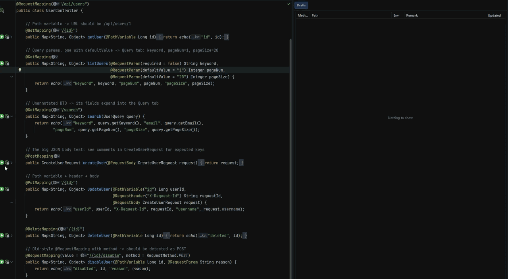

# Code2Request

**From Spring Controller to a runnable HTTP request, in one click.**

An IntelliJ IDEA plugin that turns a Spring MVC / Spring Boot controller method into a ready-to-send HTTP request, with realistic sample values. Edit what you need, hit Run, and see the response without leaving the IDE.

[中文说明](#中文说明)



## Features

- **One click**: a run icon next to every controller method (Java and Kotlin), plus a right-click action
- **Reads your code**: `@GetMapping` / `@PostMapping` / `@RequestMapping`, path variables, query params, headers, `@RequestBody`, multipart file uploads
- **Smart sample values**: `email`, `phone`, `pageSize`, `address`… get realistic data instead of `"test"`
- **Real JSON bodies**: nested DTOs, lists, maps, enums, records and Lombok classes; respects `@JsonProperty`, fastjson `@JSONField`, Gson `@SerializedName` and `@JsonIgnore`
- **Environments**: switch between local / dev / test, each with common headers such as `Authorization`
- **Drafts**: requests are saved per endpoint, so your last request is always there

Lightweight by design: no account, no cloud, no cluttered toolbar.

## Installation

In IntelliJ IDEA: **Settings → Plugins → Marketplace**, search for **Code2Request**, then install.

Requires IntelliJ IDEA 2024.1 or later (Community or Ultimate).

## Usage

1. Open a Spring controller and click the green icon next to a method.
2. Check the generated URL, headers, query params and body in the Code2Request panel.
3. Click ▶ to send. The response opens in the Response tab.
4. Click ⚙ to manage environments and common headers.

## Note on stored data

Environments (including common headers such as tokens) and saved drafts are stored in your project's `.idea` folder (`code2request-*.xml`). If your team commits `.idea` to version control, add these files to `.gitignore`.

## Feedback

Bug reports and feature requests are welcome in [Issues](../../issues).

## Building from source

```bash
./gradlew buildPlugin   # plugin zip in build/distributions
./gradlew runIde        # start a sandbox IDE with the plugin installed
```

---

## 中文说明

**点一下，Controller 方法就变成可以直接发送的请求。**

IntelliJ IDEA 插件：在 Spring MVC / Spring Boot 的 Controller 方法旁点击图标，自动读取接口路径和参数，生成带示例值的请求，改几个值就能发送，在 IDEA 里直接看响应。

### 功能

- **一键生成**：Java 和 Kotlin 的 Controller 方法旁都有运行图标，也支持右键菜单
- **读懂你的代码**：支持 `@GetMapping`、`@PostMapping`、`@RequestMapping`，路径参数、查询参数、请求头、`@RequestBody`、文件上传
- **智能示例值**：`email`、`phone`、`pageSize`、`address` 等字段自动填入真实格式的数据，而不是 `"test"`
- **完整的 JSON Body**：嵌套对象、List、Map、枚举、record、Lombok 类都能生成；支持 `@JsonProperty`、fastjson 的 `@JSONField`、Gson 的 `@SerializedName`，跳过 `@JsonIgnore` 字段
- **多环境**：local / dev / test 一键切换，每个环境可以设置公共请求头，比如 `Authorization`
- **草稿保存**：每个接口的请求自动保存，下次打开还在

轻量、干净：不用注册，不用联网，没有一堆按钮。

### 安装

IDEA 中打开 **Settings → Plugins → Marketplace**，搜索 **Code2Request** 安装。

需要 IntelliJ IDEA 2024.1 或更高版本（社区版、旗舰版都可以）。

### 使用

1. 打开 Spring Controller，点击方法旁的绿色图标。
2. 在 Code2Request 面板里检查生成的 URL、请求头、查询参数和 Body。
3. 点 ▶ 发送，响应显示在 Response 标签页。
4. 点 ⚙ 管理环境和公共请求头。

### 数据存储说明

环境配置（包括 Token 等公共请求头）和保存的草稿存放在项目的 `.idea` 目录下（`code2request-*.xml`）。如果你的团队会把 `.idea` 提交到版本库，请把这些文件加入 `.gitignore`。

### 反馈

遇到问题或有功能建议，欢迎在 [Issues](../../issues) 中提出。